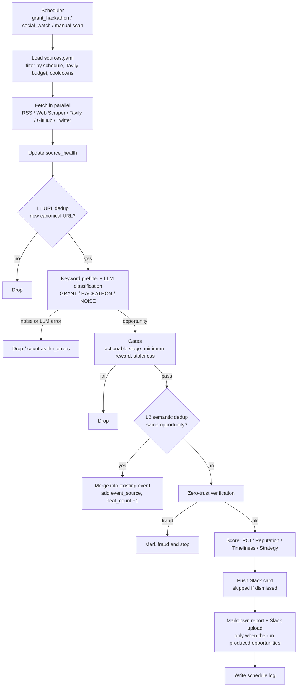

# Web3 Grant Radar

**English** | [简体中文](README.zh-CN.md)

> Track Web3 grants & hackathons — deduplicated, verified and scored.

Web3 Grant Radar continuously watches ecosystem feeds, websites, search and X/Twitter for grant programs and hackathons. Every candidate goes through deduplication, LLM classification, zero-trust verification and scoring. What survives is pushed to Slack and lands in a web dashboard where a read-only copilot helps the team dig into each opportunity.

## Features

- **Multi-source fetching**: RSS, web scraper, Tavily search, GitHub issue search and X/Twitter (Twikit), all configured in `config/sources.yaml`
- **Two-layer dedup**: L1 canonical-URL dedup, then L2 semantic dedup (ChromaDB embeddings plus deadline and ecosystem vetoes)
- **Classification and gates**: keyword prefilter, then LLM classification (DeepSeek / Qwen / Gemini with fallback), plus actionability, minimum-reward and staleness gates
- **Zero-trust verification**: origin anchoring, GitHub/domain cross-referencing and security APIs (GoPlus / CertiK / ScamSniffer); events judged as fraud are dropped
- **Scoring**: ROI, reputation, timeliness and strategic fit
- **Delivery**: Slack Block Kit cards, per-run Markdown reports, a daily summary and heartbeats
- **Grant Radar web**: a Next.js dashboard (`apps/chat-web`) with opportunities, source health, schedule logs, manual scans and a read-only verification copilot

## Architecture

| Service (`docker compose`) | Container | Role |
|---|---|---|
| `pipeline` | `grant_radar_pipeline` | Scheduler and fetch-to-dispatch pipeline (`python -m src.main`) |
| `chat-api` | `grant_radar_chat_api` | FastAPI backend for the dashboard and copilot, on `127.0.0.1:8000` |
| `postgres` | `grant_radar_postgres` | Business data (events, raw signals, source health, logs) |
| `chromadb` | `grant_radar_chromadb` | Vector index for L2 semantic dedup, on `127.0.0.1:8001` |

The web frontend (`apps/chat-web`) runs outside Docker, either with `pnpm dev` or on Vercel.

### Pipeline



## Quick start

Prerequisites: Docker with Docker Compose, at least one LLM API key, and optionally a Slack bot token.

```bash
cp .env.example .env
```

Edit `.env` (see [Configuration](#configuration)), then start everything:

```bash
docker compose up -d --build
```

Follow the logs:

```bash
docker compose logs -f --tail 200 pipeline
```

On startup the pipeline runs `grant_hackathon`, `social_watch` and `heartbeat` once immediately, then follows the schedule below.

Start the web dashboard:

```bash
cd apps/chat-web && cp .env.example .env && pnpm install && pnpm dev
```

## Configuration

Environment variables are read by `config/settings.py`. After changing `.env`, recreate the containers so the new values take effect.

| Group | Variables |
|---|---|
| Database | `POSTGRES_USER` `POSTGRES_PASSWORD` `POSTGRES_DB` `POSTGRES_HOST` `POSTGRES_PORT` |
| Vector store | `CHROMA_HOST` `CHROMA_PORT` |
| LLM | `DEEPSEEK_API_KEY` `QWEN_API_KEY` `GEMINI_API_KEY`, `LLM_PROVIDER_PRIORITY` (default `deepseek,qwen,gemini`), `LLM_TIMEOUT_SECONDS` `LLM_MAX_RETRIES` |
| Slack | `SLACK_BOT_TOKEN` `SLACK_CHANNEL_ID` |
| Search | `GITHUB_TOKEN`, `TAVILY_API_KEYS`, `TAVILY_SUCCESS_COOLDOWN_MINUTES` `TAVILY_MAX_SOURCES_PER_RUN` |
| Security APIs | `GOPLUS_API_KEY` `CERTIK_API_KEY` `SCAMSNIFFER_API_KEY` |
| Twitter | `TWITTER_AUTH_INFO_1` `TWITTER_AUTH_INFO_2` `TWITTER_PASSWORD` `TWITTER_TOTP_SECRET` `TWITTER_COOKIES_FILE` `TWITTER_FETCH_COUNT` |
| Runtime | `LOG_LEVEL` `HEARTBEAT_INTERVAL_MINUTES` `SOCIAL_WATCH_INTERVAL_MINUTES` `DAILY_SUMMARY_ENABLED` `DAILY_SUMMARY_CRON` |
| Filtering | `MIN_AMOUNT_USD` (default 5000), `STALE_MAX_AGE_DAYS` (60), `STALE_START_DATE_GRACE_DAYS` (14) |
| Chat API | `CHAT_API_INTERNAL_KEY` (must match the frontend's value) |

Frontend variables (`apps/chat-web/.env`): `CHAT_API_BASE_URL` (for example `http://127.0.0.1:8000`), `CHAT_API_INTERNAL_KEY`, `DEEPSEEK_API_KEY`, `DEEPSEEK_BASE_URL` and `CHAT_AGENT_MODEL` (default `deepseek-chat`).

### Sources

Sources live in `config/sources.yaml`. Each entry chooses a `fetch_method` (`rss`, `web_scraper`, `tavily_search`, `github_search` or `twitter`) and can carry chain metadata:

- `chain`: canonical ecosystem id; approved chains are listed in `config/chains.yaml`
- `source_tier`: `official` or `discovery` (defaults to `discovery` for search-based methods)
- `signal_type`: `grant`, `hackathon`, `social` or `discovery`

`official` sources get a trust uplift during verification and are never dropped as stale unless their deadline has passed. To add a new kind of source, implement a fetcher in `src/fetchers/`, register it in `FETCHER_MAP` in `src/fetchers/builder.py`, then add entries to `sources.yaml`.

## Schedule (Asia/Shanghai)

The source of truth is `src/scheduler/jobs.py`. The `schedules:` block in `sources.yaml` is descriptive only.

| Job | When |
|---|---|
| `grant_hackathon` | 09:00 and 21:00 daily (each run searches every enabled Tavily source, so 14 sources x 2/day) |
| `social_watch` | every `SOCIAL_WATCH_INTERVAL_MINUTES` (default 15) |
| `heartbeat` | every `HEARTBEAT_INTERVAL_MINUTES` (default 30) |
| `daily_summary` | `DAILY_SUMMARY_CRON` (default 23:55) |
| `tavily_unlock` | 00:00, clears leftover Tavily cooldown state (fallback for sources without an explicit cooldown) |

Bounties are out of scope: the `bounty` schedule is not registered, and the classifier treats bounty items as noise.

## Slack output

- **Opportunity cards**: one card per new, non-dismissed event.
- **Run report**: when a run produced opportunities, a Markdown report is written to `reports/` and uploaded to Slack. Runs with no opportunities send neither.
- **Daily summary**: sent every day with fetch, dedup and verification stats, and lists the day's new qualified opportunities with their sources.
- **Bot scopes**: `chat:write` is required; `files:write` is needed for report uploads, otherwise uploads fail with `missing_scope`.

## Grant Radar web

`apps/chat-web` is a Next.js app backed by `chat-api`:

- Dashboard: opportunities (filter, dismiss, delete), source health, schedule logs, daily summary
- Actions: manual scan, Tavily unlock, dedup reset
- Copilot: a read-only assistant that answers from database tools: target selection, verification, investigation and build proposals

The backend routes live under `/api/v1/dashboard/*`, `/api/v1/chat/*` and `/api/v1/admin/*` (see `src/chat_api/app.py`). Every route except `chat/health` requires the `X-Internal-Key` header. The frontend can be deployed to Vercel with the same `CHAT_API_*` variables. Give `chat-api` read-only database credentials and keep them separate from the pipeline's.

## Project layout

```
src/
  main.py          pipeline entry point and run_pipeline()
  scheduler/       APScheduler job registration
  fetchers/        source fetchers and registry builder
  dedup/           L1 URL dedup, L2 semantic dedup, vector index reconcile
  classifier/      keyword filter, LLM gateway, classifier, scorer
  verifier/        zero-trust verification, whitelist, security APIs
  dispatch/        Slack client, reports, heartbeat, daily summary
  db/              SQLAlchemy models and queries
  chat_api/        FastAPI backend for the dashboard and copilot
  agent/           copilot investigation service
apps/chat-web/     Grant Radar web (Next.js)
config/            sources.yaml, chains.yaml, keywords.yaml, settings.py
scripts/           ops and migration scripts
tests/             pytest suite
docs/              operations guide, audits, design specs
```

## Development

```bash
pip install -r requirements.txt && pytest -q
```

```bash
cd apps/chat-web && pnpm test
```

## Operations

Database backup and restore, ops scripts, source-health queries and troubleshooting are covered in the [operations guide](docs/operations.md) (in Chinese).
