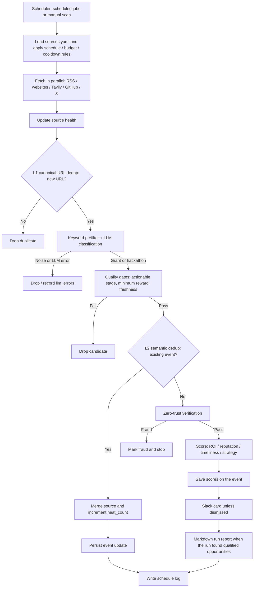

# Web3 Grant Radar

**English** | [简体中文](README.zh-CN.md)

> Track Web3 grants and hackathons — deduplicated, verified, and scored.


Web3 Grant Radar continuously monitors ecosystem feeds, project websites, Tavily search results, and X/Twitter for grant programs and hackathons. Each candidate passes through deduplication, LLM classification, zero-trust verification, and scoring. Qualified opportunities are stored, sent to Slack, and land in a web dashboard where the team triages them — shortlist or dismiss — with help from a read-only Copilot.

## Contents

- [Features](#features)
- [Architecture](#architecture)
- [Opportunity pipeline](#opportunity-pipeline)
- [Quick start](#quick-start)
- [Configuration](#configuration)
- [Sources](#sources)
- [Schedule](#schedule-asiashanghai)
- [Slack delivery](#slack-delivery)
- [Web dashboard](#grant-radar-web)
- [Project layout](#project-layout)
- [Development](#development)
- [Operations](#operations)

## Features

- **Multi-source discovery** — RSS, website scraping, Tavily search, X/Twitter via Twikit, and structured platform listings (ETHGlobal events, Superteam Earn grants, Devpost hackathons), configured centrally in `config/sources.yaml`. A GitHub issue-search fetcher is also available, though no GitHub sources are configured by default.
- **Two-stage deduplication** — L1 canonical-URL deduplication, followed by L2 semantic deduplication with ChromaDB embeddings and deadline/ecosystem vetoes.
- **LLM-assisted classification** — keyword prefiltering, then DeepSeek / Qwen / Gemini classification with provider fallback.
- **Quality gates** — reject opportunities that are not actionable, fall below the minimum reward, or are stale.
- **Zero-trust verification** — origin anchoring, a reachability cross-check of the apply/source page, and security APIs: GoPlus's phishing-site check (no key needed) plus CertiK / ScamSniffer when their keys are set. Items flagged as phishing are stopped; only an item that passes all three layers is shown as verified.
- **Opportunity scoring** — ROI, reputation, timeliness, and strategic fit.
- **Slack delivery** — Block Kit cards, per-run Markdown reports, and a daily summary.
- **Triage dashboard** — `apps/chat-web` lists new opportunities for the team to shortlist or dismiss, with on-demand verification, a read-only Copilot, and an operations page for scans, source health, and run logs.

## Architecture

The system separates scheduled opportunity discovery from dashboard/API traffic. The pipeline owns discovery and processing; `chat-api` serves the dashboard and writes only triage decisions and deletions, so give it its own database credentials.


> `docs/architecture.mmd` keeps the same components and relationships in an editable Mermaid representation; Mermaid uses its own layout, so the arrangement is not pixel-identical.

### Runtime topology

| Docker Compose service | Container | Responsibility |
|---|---|---|
| `pipeline` | `grant_radar_pipeline` | Scheduler and fetch-to-dispatch workflow; entry point: `python -m src.main` |
| `chat-api` | `grant_radar_chat_api` | FastAPI backend for the dashboard and Copilot, listening on `127.0.0.1:8000` |
| `postgres` | `grant_radar_postgres` | Events, raw signals, source health, and run logs |
| `chromadb` | `grant_radar_chromadb` | Vector index for L2 semantic deduplication, listening on `127.0.0.1:8001` |

The Next.js frontend (`apps/chat-web`) runs outside Docker. Start it locally with `pnpm dev` or deploy it to Vercel.

## Opportunity pipeline

The pipeline runs scheduled jobs or a manual scan, then filters candidates before they reach the scoring and delivery stages.



## Quick start

**Prerequisites:** Docker with Docker Compose, at least one LLM API key, and (optionally) a Slack bot token.

1. Create your environment file:

   ```bash
   cp .env.example .env
   ```

2. Edit `.env` as described in [Configuration](#configuration), then build and start the services:

   ```bash
   docker compose up -d --build
   ```

3. Follow the pipeline logs:

   ```bash
   docker compose logs -f --tail 200 pipeline
   ```

At startup, the pipeline immediately runs `grant_hackathon`, `social_watch`, and `heartbeat` once, then follows the configured schedule.

Start the web dashboard in a separate terminal:

```bash
cd apps/chat-web
cp .env.example .env
pnpm install
pnpm dev
```

## Configuration

Environment variables are read by `config/settings.py`. Recreate the containers after changing `.env` so the new values take effect.

| Group | Variables |
|---|---|
| Database | `POSTGRES_USER`, `POSTGRES_PASSWORD`, `POSTGRES_DB`, `POSTGRES_HOST`, `POSTGRES_PORT` |
| Vector store | `CHROMA_HOST`, `CHROMA_PORT` |
| LLM | `DEEPSEEK_API_KEY`, `QWEN_API_KEY`, `GEMINI_API_KEY`, `LLM_PROVIDER_PRIORITY` (default: `deepseek,qwen,gemini`), `LLM_TIMEOUT_SECONDS`, `LLM_MAX_RETRIES` |
| Slack | `SLACK_BOT_TOKEN`, `SLACK_CHANNEL_ID` |
| Search | `GITHUB_TOKEN`, `TAVILY_API_KEYS`, `TAVILY_SUCCESS_COOLDOWN_MINUTES`, `TAVILY_MAX_SOURCES_PER_RUN` |
| Security APIs | `GOPLUS_API_KEY`, `CERTIK_API_KEY`, `SCAMSNIFFER_API_KEY` |
| Twitter | `TWITTER_AUTH_INFO_1`, `TWITTER_AUTH_INFO_2`, `TWITTER_PASSWORD`, `TWITTER_TOTP_SECRET`, `TWITTER_COOKIES_FILE`, `TWITTER_FETCH_COUNT`, `TWITTER_MAX_TWEET_AGE_DAYS` (default: `30`), `RSS_MAX_ENTRIES` (default: `30`) |
| Runtime | `LOG_LEVEL`, `HEARTBEAT_INTERVAL_MINUTES`, `SOCIAL_WATCH_INTERVAL_MINUTES`, `DAILY_SUMMARY_ENABLED`, `DAILY_SUMMARY_CRON`, `SCHEDULER_MISFIRE_GRACE_MINUTES` (default: `720`), `PIPELINE_STALE_ALERT_HOURS` (default: `14`), `RAW_SIGNAL_MAX_ATTEMPTS` (default: `3`), `RAW_SIGNAL_PENDING_TIMEOUT_MINUTES` (default: `120`) |
| Filtering | `MIN_AMOUNT_USD` (default: `5000`), `STALE_MAX_AGE_DAYS` (default: `60`), `STALE_START_DATE_GRACE_DAYS` (default: `14`) |
| Chat API | `CHAT_API_INTERNAL_KEY`: required, at least 16 random characters, and the same value as in `apps/chat-web/.env`. `chat-api` refuses to start without it |

Frontend variables in `apps/chat-web/.env` include `CHAT_API_BASE_URL` (for example, `http://127.0.0.1:8000`), `CHAT_API_INTERNAL_KEY`, `DEEPSEEK_API_KEY`, `DEEPSEEK_BASE_URL`, and `CHAT_AGENT_MODEL` (default: `deepseek-chat`).

## Sources

Sources are defined in `config/sources.yaml`. Each entry selects a `fetch_method`: `rss`, `web_scraper`, `tavily_search`, `github_search`, `twitter`, or one of the structured platform listings `ethglobal_events`, `superteam_grants` and `devpost_api`, which emit one item per hackathon or grant with its own URL, dates and reward. Optional metadata includes:

- `chain` — canonical ecosystem ID; approved chains are listed in `config/chains.yaml`.
- `source_tier` — `official` or `discovery`. Search-based sources default to `discovery`.
- `signal_type` — `grant`, `hackathon`, `social`, or `discovery`.

Official sources receive a trust uplift during verification. They are discarded as stale when their deadline has passed, or when the source dated the item (feed entry, tweet) more than `STALE_MAX_AGE_DAYS` ago with no deadline, unless the content says applications are rolling. Undated official pages are kept. Tweets older than `TWITTER_MAX_TWEET_AGE_DAYS` are skipped at fetch time, and every run reads each account's newest tweets. To add a source type, implement a fetcher under `src/fetchers/`, register it in `FETCHER_MAP` in `src/fetchers/builder.py`, and add entries to `sources.yaml`.

## Schedule (Asia/Shanghai)

The source of truth is `src/scheduler/jobs.py`. The `schedules:` block in `sources.yaml` is descriptive; the code does not read it.

| Job | When |
|---|---|
| `grant_hackathon` | Daily at 09:00 and 21:00; every enabled Tavily source is searched in each run |
| `social_watch` | Every `SOCIAL_WATCH_INTERVAL_MINUTES` minutes (default: 15) |
| `heartbeat` | Every `HEARTBEAT_INTERVAL_MINUTES` minutes (default: 30); collects run and source-health stats. Sends a Slack alert, once per outage, when `grant_hackathon` has not completed successfully for `PIPELINE_STALE_ALERT_HOURS` hours, or when an enabled source goes `down` |
| `daily_summary` | According to `DAILY_SUMMARY_CRON` (default: 23:55) |
| `tavily_unlock` | Daily at 00:00; clears the Tavily success cooldowns |

A run missed while the host was asleep or busy still fires when the scheduler wakes up, up to `SCHEDULER_MISFIRE_GRACE_MINUTES` late (the daily summary only up to an hour late), and a backlog of missed runs collapses into a single run.

Bounties are out of scope: the `bounty` job is not registered, and the classifier treats bounty items as noise.

## Slack delivery

- **Opportunity cards:** one card per new event that has not been dismissed.
- **Run report:** when a run produces qualified opportunities, a Markdown report is written under `reports/` and uploaded to Slack. Runs with no qualified opportunities send neither cards nor reports.
- **Daily summary:** includes fetch, deduplication, and verification stats plus newly qualified opportunities and their sources.
- **Bot scopes:** `chat:write` is required. `files:write` is also needed for report uploads; without it, uploads fail with `missing_scope`.

## Grant Radar Web

`apps/chat-web` is a Next.js app backed by `chat-api`, with two pages:

- **Triage** (`/`): the opportunity list on the left, the selected opportunity on the right. Each opportunity is *New*, *Shortlisted*, or *Dismissed*; the decision is stored in `events.triage_status` and shared by the whole team. Search, filters, sorting, and the selection live in the URL, so a link opens the same view. Keyboard: `J`/`K` move, `S` shortlist, `D` dismiss, `Z` undo, `O` open the apply page (or the source when no apply link was found), `/` search. Opportunities past their deadline are marked expired after each run and leave the list (shortlisted ones stay); a missing deadline reads *rolling* only when the programme says applications are rolling, otherwise *deadline not stated*. Amounts in tokens show a rough USD estimate, and the list can be sorted by reward.
- **Detail tabs:** *Overview* (summary, score breakdown, sources), *Verification* (trust score, evidence, similar past events, ways to take part; runs on request), and *Ask Copilot* (a read-only assistant that answers from database tools).
- **Operations** (`/operations`): manual scan, source health (problems first), recent runs, and maintenance actions — send the daily summary, unlock Tavily sources, reset the dedup index.

Backend routes live under `/api/v1/dashboard/*`, `/api/v1/chat/*`, and `/api/v1/admin/*` (see `src/chat_api/app.py`). Every route except `chat/health` requires the `X-Internal-Key` header. Auth fails closed: `chat-api` refuses to start when `CHAT_API_INTERNAL_KEY` is missing or shorter than 16 characters, and rejects requests if the key is ever unset. The frontend can be deployed to Vercel with the same `CHAT_API_*` variables. `chat-api` writes triage decisions and deletions, so it needs write access to `events`; keep its credentials separate from the pipeline's. `docker-compose.yml` currently gives both services the same `.env`, so they share database credentials until you split them.

## Project layout

```text
src/
  main.py          Pipeline entry point and run_pipeline()
  scheduler/       APScheduler job registration
  fetchers/        Fetchers and registry builder
  dedup/           L1 URL dedup, L2 semantic dedup, vector-index reconciliation
  classifier/      Keyword filter, LLM gateway, classifier, scorer
  verifier/        Zero-trust verification, whitelist, security APIs
  dispatch/        Slack client, reports, heartbeat, daily summary
  db/              SQLAlchemy models and queries
  chat_api/        FastAPI backend for dashboard and Copilot
  agent/           Copilot investigation service
apps/chat-web/     Next.js dashboard
config/            sources.yaml, chains.yaml, keywords.yaml, settings.py
scripts/           Operations and migration scripts
tests/             pytest suite
docs/              Operations guide, audits, and design docs
```

## Development

```bash
pip install -r requirements.txt
pytest -q
```

```bash
cd apps/chat-web
pnpm test
```

## Operations

Database backup and restore, migrations (run `scripts/migrate_events_triage_status.py` before upgrading to the triage dashboard, and `scripts/migrate_raw_signals_processing_state.py` before upgrading to failed-signal retries), operations scripts, source-health queries, and troubleshooting are covered in the [operations guide](docs/operations.md) (in Chinese).
