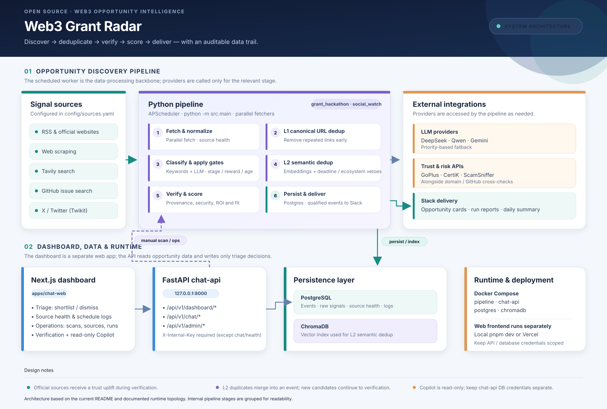
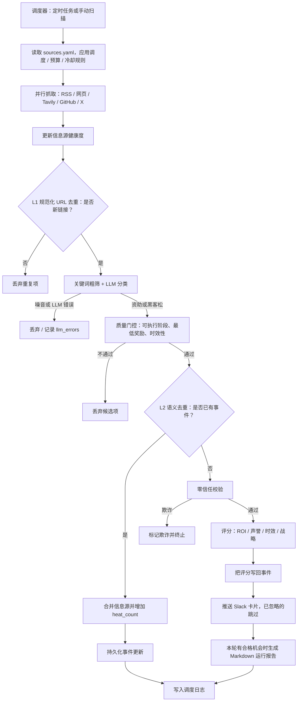

# Web3 Grant Radar

[English](README.md) | **简体中文**

> 追踪 Web3 资助（Grants）与黑客松（Hackathons）机会：发现、去重、校验、评分，一站完成。


Web3 Grant Radar 持续监控各生态公告源、项目官网、Tavily 搜索结果和 X/Twitter，发现资助计划与黑客松机会。候选信息会经过多层去重、LLM 分类、零信任校验和评分。符合条件的机会会保存到数据库、推送到 Slack，并进入 Web 面板，由团队逐条决定跟进或忽略；面板还内置一个只读 Copilot，帮助团队进一步分析机会。

## 目录

- [功能特性](#功能特性)
- [系统架构](#系统架构)
- [机会处理流程](#机会处理流程)
- [快速开始](#快速开始)
- [配置](#配置)
- [信息源](#信息源)
- [调度策略](#调度策略asiashanghai)
- [Slack 推送](#slack-推送)
- [Grant Radar Web](#grant-radar-web)
- [目录结构](#目录结构)
- [开发](#开发)
- [运维](#运维)

## 功能特性

- **多源发现**：支持 RSS、网页抓取、Tavily 搜索、X/Twitter（Twikit），以及平台结构化列表（ETHGlobal 活动、Superteam Earn 资助、Devpost 黑客松），统一在 `config/sources.yaml` 中配置。代码里也提供 GitHub Issue 搜索抓取器，但默认没有配置 GitHub 信息源。
- **双层去重**：L1 根据规范化 URL 去重；L2 使用 ChromaDB 向量语义去重，并结合截止日期、生态信息进行否决判断。
- **LLM 辅助分类**：先进行关键词粗筛，再用 DeepSeek-V4.1-Flash（`deepseek-flash`，思考模式）分类。Qwen 和 Gemini 是可选的降级备份，只在配置了 API Key 时才会启用。
- **质量门控**：过滤不可执行、低于最低奖励金额或信息过期的机会。
- **零信任校验**：来源锚定、申请页/来源页的可访问性交叉核对，以及安全 API：GoPlus 钓鱼网站检测（无需 key），配置了 key 时再加上 CertiK / ScamSniffer。被判为钓鱼的项目会终止处理；三层都通过的才显示为已验证。
- **机会评分**：综合 ROI、声誉、时效性和战略契合度。
- **Slack 推送**：Block Kit 卡片、单轮 Markdown 报告和每日汇总。
- **机会处理面板**：`apps/chat-web` 列出新机会，由团队逐条决定跟进或忽略；支持按需校验、只读 Copilot，另有运维页查看扫描、信息源健康度和运行日志。

## 系统架构

系统将定时发现流水线与面板/API 请求分离：pipeline 负责发现和处理机会；`chat-api` 为面板提供接口，只会写入处理状态和删除记录，应为它配置独立的数据库凭据。



> `docs/architecture.mmd` 以可编辑的 Mermaid 形式维护相同的组件与连接关系；由于 Mermaid 会独立计算布局，排列方式不会与 SVG 逐像素相同。

### 运行服务

| Docker Compose 服务 | 容器名 | 职责 |
|---|---|---|
| `pipeline` | `grant_radar_pipeline` | 调度及从抓取到分发的完整链路，入口为 `python -m src.main` |
| `chat-api` | `grant_radar_chat_api` | 面板和 Copilot 使用的 FastAPI 后端，监听 `127.0.0.1:8000` |
| `postgres` | `grant_radar_postgres` | 保存事件、原始信号、信息源健康度和运行日志 |
| `chromadb` | `grant_radar_chromadb` | L2 语义去重的向量索引，监听 `127.0.0.1:8001` |

本地开发时，Next.js 前端（`apps/chat-web`）不在 Docker 中运行，通过 `pnpm dev` 启动。生产环境由 `docker-compose.prod.yml` 把它作为 `web` 容器，和 Caddy（HTTPS）一起部署在一台 EC2 上，见 [docs/deploy-aws.md](docs/deploy-aws.md)。

## 机会处理流程

流水线由定时任务或手动扫描触发，候选信息需要通过分类、质量门控、语义去重和信任校验，才会进入评分及分发阶段。



## 快速开始

**前置条件：** Docker（含 Docker Compose）、至少一个 LLM API Key；如需 Slack 推送，还需要 Slack Bot Token。

1. 创建环境变量文件：

   ```bash
   cp .env.example .env
   ```

2. 按[配置](#配置)一节编辑 `.env`，然后构建并启动服务：

   ```bash
   docker compose up -d --build
   ```

3. 查看流水线日志：

   ```bash
   docker compose logs -f --tail 200 pipeline
   ```

启动后会立即执行一次 `grant_hackathon`、`social_watch` 和 `heartbeat`，之后再按调度策略运行。

在另一个终端启动 Web 面板：

```bash
cd apps/chat-web
cp .env.example .env
pnpm install
pnpm dev
```

## 配置

环境变量由 `config/settings.py` 读取。修改 `.env` 后，需要重建容器才能让新值生效。

| 分组 | 变量 |
|---|---|
| 数据库 | `POSTGRES_USER`、`POSTGRES_PASSWORD`、`POSTGRES_DB`、`POSTGRES_HOST`、`POSTGRES_PORT` |
| 向量库 | `CHROMA_HOST`、`CHROMA_PORT` |
| LLM | `DEEPSEEK_API_KEY`、`DEEPSEEK_MODEL`（默认：`deepseek-flash`）、`DEEPSEEK_THINKING`（默认：`true`；推理按输出 token 计费，实测每次调用多 2–3k token、耗时 12–18 秒，关闭时不到 1 秒）、`QWEN_API_KEY`、`GEMINI_API_KEY`、`LLM_PROVIDER_PRIORITY`（默认：`deepseek,qwen,gemini`）、`LLM_TIMEOUT_SECONDS`、`LLM_MAX_RETRIES` |
| Slack | `SLACK_BOT_TOKEN`、`SLACK_CHANNEL_ID` |
| 搜索 | `GITHUB_TOKEN`、`TAVILY_API_KEYS`、`TAVILY_SUCCESS_COOLDOWN_MINUTES`、`TAVILY_MAX_SOURCES_PER_RUN` |
| 安全 API | `GOPLUS_API_KEY`、`CERTIK_API_KEY`、`SCAMSNIFFER_API_KEY` |
| Twitter | `TWITTER_AUTH_INFO_1`、`TWITTER_AUTH_INFO_2`、`TWITTER_PASSWORD`、`TWITTER_TOTP_SECRET`、`TWITTER_COOKIES_FILE`、`TWITTER_FETCH_COUNT`、`TWITTER_MAX_TWEET_AGE_DAYS`（默认：`30`）、`RSS_MAX_ENTRIES`（默认：`30`） |
| 运行 | `LOG_LEVEL`、`HEARTBEAT_INTERVAL_MINUTES`、`SOCIAL_WATCH_INTERVAL_MINUTES`、`DAILY_SUMMARY_ENABLED`、`DAILY_SUMMARY_CRON`、`SCHEDULER_MISFIRE_GRACE_MINUTES`（默认：`720`）、`PIPELINE_STALE_ALERT_HOURS`（默认：`14`）、`RAW_SIGNAL_MAX_ATTEMPTS`（默认：`3`）、`RAW_SIGNAL_PENDING_TIMEOUT_MINUTES`（默认：`120`） |
| 过滤 | `MIN_AMOUNT_USD`（默认：`5000`）、`STALE_MAX_AGE_DAYS`（默认：`60`）、`STALE_START_DATE_GRACE_DAYS`（默认：`14`） |
| Chat API | `CHAT_API_INTERNAL_KEY`：必填，至少 16 位随机字符，并与 `apps/chat-web/.env` 中的值一致；缺失时 `chat-api` 拒绝启动 |

`apps/chat-web/.env` 中的前端变量包括 `CHAT_API_BASE_URL`（例如 `http://127.0.0.1:8000`）、`CHAT_API_INTERNAL_KEY`、`DEEPSEEK_API_KEY`、`DEEPSEEK_BASE_URL`、`CHAT_AGENT_MODEL`（默认：`deepseek-flash`）和 `DEEPSEEK_THINKING`（默认：`true`）。

## 信息源

信息源配置在 `config/sources.yaml`。每项通过 `fetch_method` 指定抓取方式：`rss`、`web_scraper`、`tavily_search`、`github_search`、`twitter`，或者平台结构化列表 `ethglobal_events`、`superteam_grants`、`devpost_api`；后三种每个黑客松或资助生成一条，自带链接、日期和奖金。可选元数据包括：

- `chain`：生态规范 ID；已批准的链列在 `config/chains.yaml` 中。
- `source_tier`：`official` 或 `discovery`；搜索发现类信息源默认为 `discovery`。
- `signal_type`：`grant`、`hackathon`、`social` 或 `discovery`。

官方信息源在校验阶段会获得信任加权。以下两种情况会被当作过期丢弃：截止日期已过；或者信息源自己标注的发布时间（feed 条目、推文）早于 `STALE_MAX_AGE_DAYS` 天且没有截止日期，除非内容写明是滚动申请。没有日期的官方页面会保留。超过 `TWITTER_MAX_TWEET_AGE_DAYS` 天的推文在抓取阶段直接跳过，每轮都从各账号最新的推文读起。新增信息源类型时，在 `src/fetchers/` 实现 fetcher，在 `src/fetchers/builder.py` 的 `FETCHER_MAP` 中注册，再在 `sources.yaml` 中添加配置。

## 调度策略（Asia/Shanghai）

调度以 `src/scheduler/jobs.py` 为准。`sources.yaml` 中的 `schedules:` 只是说明信息，代码不会读取它。

| 任务 | 触发时间 |
|---|---|
| `grant_hackathon` | 每天 09:00 和 21:00；每轮搜索所有启用的 Tavily 信息源 |
| `social_watch` | 每 `SOCIAL_WATCH_INTERVAL_MINUTES` 分钟执行一次（默认：15） |
| `heartbeat` | 每 `HEARTBEAT_INTERVAL_MINUTES` 分钟执行一次（默认：30），统计运行和信息源健康数据。`grant_hackathon` 连续 `PIPELINE_STALE_ALERT_HOURS` 小时没有成功完成时，或者某个启用中的信息源变为 `down` 时，发一次 Slack 告警（每次中断只发一次） |
| `daily_summary` | 按 `DAILY_SUMMARY_CRON` 执行（默认：23:55） |
| `tavily_unlock` | 每天 00:00 清除 Tavily 信息源的成功冷却 |

主机休眠或繁忙时错过的任务，会在调度器恢复后补跑，最多可以晚 `SCHEDULER_MISFIRE_GRACE_MINUTES` 分钟（日报最多晚 1 小时）；积压的多次错过只补跑一次。

Bounty 不在系统范围内：`bounty` 任务没有注册，分类器也会把 bounty 类信息视为噪音。

## Slack 推送

- **机会卡片：** 每个新出现且未被忽略的事件推送一张卡片。
- **运行报告：** 本轮产生合格机会时，在 `reports/` 生成 Markdown 报告并上传 Slack；没有合格机会时，不发送卡片或报告。
- **每日汇总：** 包含抓取、去重、校验统计，以及当天新增的合格机会和信息源。
- **Bot 权限：** 必须有 `chat:write`；上传报告还需要 `files:write`，否则会出现 `missing_scope`。

## Grant Radar Web

`apps/chat-web` 是一个 Next.js 应用，后端是 `chat-api`。`/` 是静态落地页，介绍处理流程并提供进入控制台的入口；控制台包含两个页面：

- **机会处理页**（`/triage`）：左边是机会列表，右边是当前选中机会的详情。每条机会处于 *New*（待处理）、*Shortlisted*（跟进）或 *Dismissed*（忽略）三种状态之一，状态存在 `events.triage_status` 字段里，整个团队共享。搜索、筛选、排序和当前选中项都记录在 URL 里，把链接发给同事就能打开同一个视图。快捷键：`J`/`K` 上下移动，`S` 跟进，`D` 忽略，`Z` 撤销，`O` 打开申请页（没有申请链接时打开来源页），`/` 搜索。截止日期已过的机会在每轮运行后标为已过期并移出列表（已跟进的保留）；没有截止日期时，只有内容写明滚动申请才显示 *rolling*，否则显示 *deadline not stated*。以代币计价的金额会附上大致的美元估值，列表可以按奖金排序。落地页上线前的旧链接（`/?id=…`）会带着原查询参数重定向到 `/triage`。
- **详情标签页：** *Overview*（简介、分项评分、来源）、*Verification*（可信度评分、证据、相似历史事件、参与方式；点击后才运行）、*Ask Copilot*（只读助手，回答都基于数据库工具）。
- **运维页**（`/operations`）：手动扫描、信息源健康度（默认只列出有问题的源）、最近运行记录，以及维护操作：立即发送日报、解除 Tavily 锁、重置去重索引。

后端接口位于 `/api/v1/dashboard/*`、`/api/v1/chat/*` 和 `/api/v1/admin/*`（参见 `src/chat_api/app.py`）。除 `chat/health` 外，其余接口都需要 `X-Internal-Key` 请求头。鉴权默认拒绝：`CHAT_API_INTERNAL_KEY` 缺失或短于 16 位时 `chat-api` 拒绝启动；运行中 key 被清空，所有请求也会被拒绝。前端可以部署到 Vercel，并配置相同的 `CHAT_API_*` 变量。`chat-api` 会写入处理状态和删除记录，因此需要 `events` 表的写权限；它的凭据应与 pipeline 分开。目前 `docker-compose.yml` 让两个服务读取同一份 `.env`，在拆分之前它们共用同一套数据库凭据。

## 目录结构

```text
src/
  main.py          流水线入口与 run_pipeline()
  scheduler/       APScheduler 任务注册
  fetchers/        抓取器与注册表构建
  dedup/           L1 URL 去重、L2 语义去重、向量索引对账
  classifier/      关键词过滤、LLM 网关、分类器、评分器
  verifier/        零信任校验、白名单、安全 API
  dispatch/        Slack、报告、心跳、每日汇总
  db/              SQLAlchemy 模型与查询
  chat_api/        面板和 Copilot 使用的 FastAPI 后端
  agent/           Copilot 调查服务
apps/chat-web/     Next.js Web 面板
config/            sources.yaml、chains.yaml、keywords.yaml、settings.py
scripts/           运维及迁移脚本
tests/             pytest 测试
docs/              运维手册、审计报告、设计文档
```

## 开发

```bash
pip install -r requirements.txt
pytest -q
```

```bash
cd apps/chat-web
pnpm test
```

## 运维

数据库备份和恢复、数据库迁移（升级到机会处理面板前需先执行 `scripts/migrate_events_triage_status.py`，升级到失败信号重试前需先执行 `scripts/migrate_raw_signals_processing_state.py`）、运维脚本、信息源健康度查询及常见问题排查，请参阅[运维手册](docs/operations.md)。
