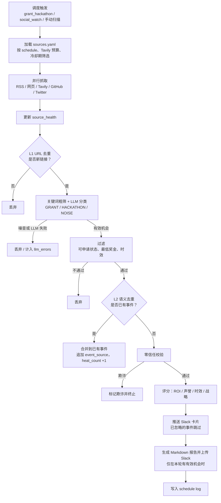

# Web3 Grant Radar

[English](README.md) | **简体中文**

> 追踪 Web3 资助（Grants）与黑客松（Hackathons）机会：去重、校验、评分，一站完成。

Web3 Grant Radar（Web3 资助雷达）持续监控各生态的公告源、官网、搜索结果和 X/Twitter，从中发现资助计划和黑客松。每条候选信息都要经过去重、LLM 分类、零信任校验和评分，最终留下来的有效机会会推送到 Slack，并汇总到 Web 面板。面板里有一个只读 Copilot，可以帮助团队深入分析每个机会。

## 功能特性

- **多源抓取**：支持 RSS、网页抓取、Tavily 搜索、GitHub Issue 搜索和 X/Twitter（Twikit），统一在 `config/sources.yaml` 中配置
- **双层去重**：L1 按规范化 URL 去重；L2 做语义去重（基于 ChromaDB 向量，并用截止日期和生态做否决判断）
- **分类与过滤**：先做关键词粗筛，再交给 LLM 分类（DeepSeek / Qwen / Gemini，按优先级降级）；之后还要经过可申请状态、最低奖金和时效三道过滤
- **零信任校验**：来源锚定、GitHub 与域名交叉验证、安全 API（GoPlus / CertiK / ScamSniffer）；被判定为欺诈的事件直接丢弃
- **机会评分**：从 ROI、声誉、时效性和战略契合度四个维度打分
- **消息分发**：Slack Block Kit 卡片、每轮 Markdown 报告、每日汇总和心跳
- **Grant Radar Web**：Next.js 面板（`apps/chat-web`），用于每天筛选机会：逐条决定跟进或忽略、做校验，也可以向只读 Copilot 提问

## 系统架构

| 服务（`docker compose`） | 容器名 | 职责 |
|---|---|---|
| `pipeline` | `grant_radar_pipeline` | 调度器，负责从抓取到分发的完整链路（`python -m src.main`） |
| `chat-api` | `grant_radar_chat_api` | FastAPI 后端，为面板和 Copilot 提供接口，监听 `127.0.0.1:8000` |
| `postgres` | `grant_radar_postgres` | 业务数据（事件、原始信号、信息源健康度、日志） |
| `chromadb` | `grant_radar_chromadb` | L2 语义去重使用的向量索引，监听 `127.0.0.1:8001` |

Web 前端（`apps/chat-web`）不在 Docker 中运行，可以用 `pnpm dev` 在本地启动，也可以部署到 Vercel。

### 处理流程



## 快速开始

前置条件：Docker（含 Docker Compose）、至少一个 LLM API Key；如果需要推送到 Slack，还需要 Slack Bot Token。

```bash
cp .env.example .env
```

按[配置](#配置)一节编辑 `.env`，然后启动全部服务：

```bash
docker compose up -d --build
```

查看日志：

```bash
docker compose logs -f --tail 200 pipeline
```

启动后会先立即执行一次 `grant_hackathon`、`social_watch` 和 `heartbeat`，之后按下方的调度表运行。

启动 Web 面板：

```bash
cd apps/chat-web && cp .env.example .env && pnpm install && pnpm dev
```

## 配置

环境变量由 `config/settings.py` 读取。修改 `.env` 后，需要重建容器才能生效。

| 分组 | 变量 |
|---|---|
| 数据库 | `POSTGRES_USER` `POSTGRES_PASSWORD` `POSTGRES_DB` `POSTGRES_HOST` `POSTGRES_PORT` |
| 向量库 | `CHROMA_HOST` `CHROMA_PORT` |
| LLM | `DEEPSEEK_API_KEY` `QWEN_API_KEY` `GEMINI_API_KEY`、`LLM_PROVIDER_PRIORITY`（默认 `deepseek,qwen,gemini`）、`LLM_TIMEOUT_SECONDS` `LLM_MAX_RETRIES` |
| Slack | `SLACK_BOT_TOKEN` `SLACK_CHANNEL_ID` |
| 搜索 | `GITHUB_TOKEN`、`TAVILY_API_KEYS`、`TAVILY_SUCCESS_COOLDOWN_MINUTES` `TAVILY_MAX_SOURCES_PER_RUN` |
| 安全 API | `GOPLUS_API_KEY` `CERTIK_API_KEY` `SCAMSNIFFER_API_KEY` |
| Twitter | `TWITTER_AUTH_INFO_1` `TWITTER_AUTH_INFO_2` `TWITTER_PASSWORD` `TWITTER_TOTP_SECRET` `TWITTER_COOKIES_FILE` `TWITTER_FETCH_COUNT` |
| 运行 | `LOG_LEVEL` `HEARTBEAT_INTERVAL_MINUTES` `SOCIAL_WATCH_INTERVAL_MINUTES` `DAILY_SUMMARY_ENABLED` `DAILY_SUMMARY_CRON` |
| 过滤 | `MIN_AMOUNT_USD`（默认 5000）、`STALE_MAX_AGE_DAYS`（60）、`STALE_START_DATE_GRACE_DAYS`（14） |
| Chat API | `CHAT_API_INTERNAL_KEY`（需要和前端配置的值一致） |

前端变量（`apps/chat-web/.env`）：`CHAT_API_BASE_URL`（例如 `http://127.0.0.1:8000`）、`CHAT_API_INTERNAL_KEY`、`DEEPSEEK_API_KEY`、`DEEPSEEK_BASE_URL`、`CHAT_AGENT_MODEL`（默认 `deepseek-chat`）。

### 信息源

信息源在 `config/sources.yaml` 中配置。每条 source 通过 `fetch_method` 指定抓取方式（`rss`、`web_scraper`、`tavily_search`、`github_search` 或 `twitter`），还可以附带链相关的元数据：

- `chain`：生态的规范 id；已批准的链列在 `config/chains.yaml` 中
- `source_tier`：`official` 或 `discovery`（基于搜索的抓取方式默认为 `discovery`）
- `signal_type`：`grant`、`hackathon`、`social` 或 `discovery`

`official` 源在校验阶段会获得更高的信任度，并且只要截止日期没过，就不会因为时效原因被丢弃。如果要新增一种信息源类型，先在 `src/fetchers/` 中实现 fetcher，在 `src/fetchers/builder.py` 的 `FETCHER_MAP` 中注册，再到 `sources.yaml` 里添加条目。

## 调度策略（Asia/Shanghai）

调度以 `src/scheduler/jobs.py` 为准，`sources.yaml` 中的 `schedules:` 段只是说明，代码不会读取。

| 任务 | 触发时间 |
|---|---|
| `grant_hackathon` | 每天 09:00 和 21:00（每轮覆盖全部启用的 Tavily 源，即 14 个源 x 每天 2 次） |
| `social_watch` | 每 `SOCIAL_WATCH_INTERVAL_MINUTES` 分钟（默认 15） |
| `heartbeat` | 每 `HEARTBEAT_INTERVAL_MINUTES` 分钟（默认 30） |
| `daily_summary` | 按 `DAILY_SUMMARY_CRON`（默认 23:55） |
| `tavily_unlock` | 每天 00:00，清理残留的 Tavily 冷却状态（未显式配置冷却的源走这条兜底） |

Bounty 不在系统范围内：`bounty` 调度不会注册，分类器也会把 bounty 类信息判为噪音。

## Slack 推送

- **机会卡片**：每个新增且未被忽略的事件推送一张卡片。
- **运行报告**：本轮有有效机会时，在 `reports/` 下生成 Markdown 报告并上传到 Slack；没有有效机会时，卡片和报告都不发。
- **每日汇总**：每天固定发送，包含抓取、去重和校验的统计，并列出当天新增的合格机会及其来源。
- **Bot 权限**：必须有 `chat:write`；上传报告还需要 `files:write`，缺少时上传会报 `missing_scope`。

## Grant Radar Web

`apps/chat-web` 是一个 Next.js 应用，后端是 `chat-api`，包含两个页面：

- **机会处理页**（`/`）：左边是机会列表，右边是当前选中机会的详情。每条机会处于 *New*（待处理）、*Shortlisted*（跟进）或 *Dismissed*（忽略）三种状态之一，状态存在 `events.triage_status` 字段里，整个团队共享。搜索、筛选、排序和当前选中项都记录在 URL 里，把链接发给同事就能打开同一个视图。快捷键：`J`/`K` 上下移动，`S` 跟进，`D` 忽略，`Z` 撤销，`O` 打开申请页，`/` 搜索。
- **运维页**（`/operations`）：手动扫描、信息源健康度（默认只列出有问题的源）、最近运行记录，以及维护操作（立即发送日报、解除 Tavily 锁、重置去重索引）。
- **详情标签页**：*Overview*（简介、分项评分、来源）、*Verification*（可信度评分、证据、相似历史事件、参与方式；点击后才运行）、*Ask Copilot*（只读助手，回答都基于数据库工具）。

后端接口分布在 `/api/v1/dashboard/*`、`/api/v1/chat/*` 和 `/api/v1/admin/*` 下（见 `src/chat_api/app.py`）。除 `chat/health` 外，其他接口都需要带 `X-Internal-Key` 请求头。前端可以部署到 Vercel，配置同样的 `CHAT_API_*` 变量即可。`chat-api` 会写入处理状态和删除记录，因此需要 `events` 表的写权限；它的凭据应与 pipeline 分开。

## 目录结构

```
src/
  main.py          主入口与 run_pipeline()
  scheduler/       APScheduler 任务注册
  fetchers/        各类抓取器与注册表构建
  dedup/           L1 URL 去重、L2 语义去重、向量索引对账
  classifier/      关键词过滤、LLM 网关、分类器、评分器
  verifier/        零信任校验、白名单、安全 API
  dispatch/        Slack、报告、心跳、每日汇总
  db/              SQLAlchemy 模型与查询
  chat_api/        面板与 Copilot 使用的 FastAPI 后端
  agent/           Copilot 调查服务
apps/chat-web/     Grant Radar Web（Next.js）
config/            sources.yaml、chains.yaml、keywords.yaml、settings.py
scripts/           运维与迁移脚本
tests/             pytest 测试
docs/              运维手册、审计报告、设计文档
```

## 开发

```bash
pip install -r requirements.txt && pytest -q
```

```bash
cd apps/chat-web && pnpm test
```

## 运维

数据库备份与恢复、运维脚本、信息源健康度查询和常见问题排查，请参阅[运维手册](docs/operations.md)。
